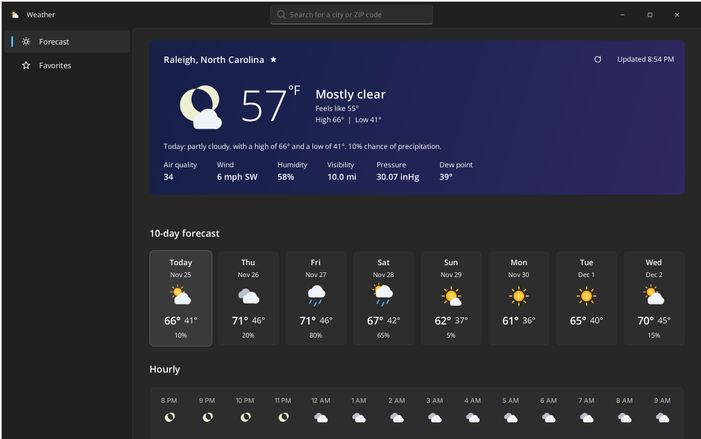
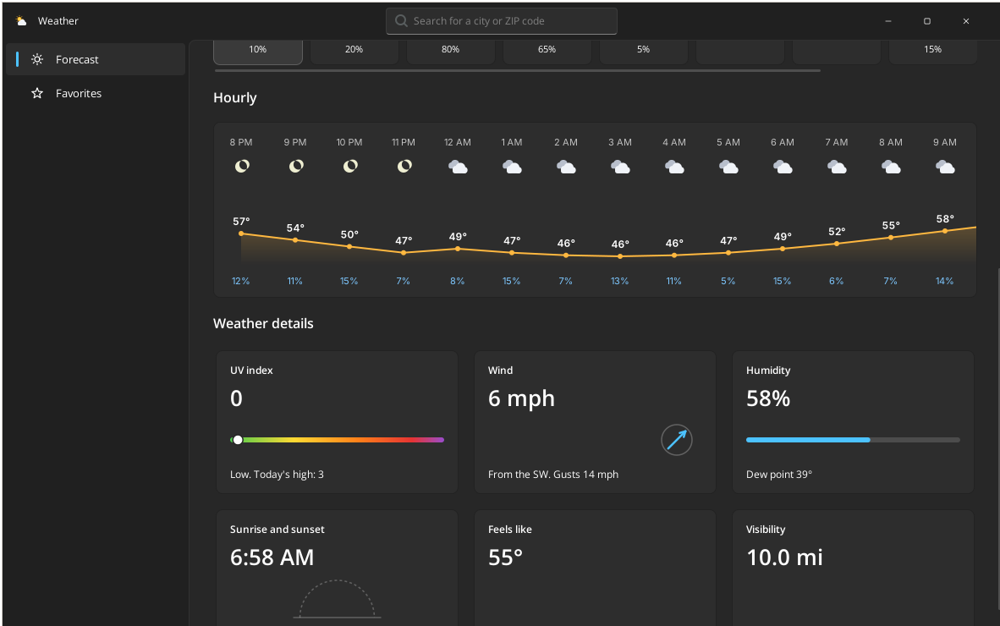

# pi-weather

A Windows 11 style Weather app for the Raspberry Pi (built for the Pi 5, works on other Pis running Raspberry Pi OS). Native GTK app with the Windows 11 dark look, made to match [pi-explorer](https://github.com/wvfouram/pi-explorer) and [pi-taskmgr](https://github.com/wvfouram/pi-taskmgr).



## Features

- **Search any city** worldwide and see the current conditions
- **10-day forecast**; click a day to see its hours
- **Hourly** temperature chart with conditions and chance of rain
- **Weather details**: UV index, wind with direction, humidity, sunrise and sunset, feels like, visibility, pressure, air quality and precipitation
- **Favorites**: every place you search is saved; switch between them with one click
- Units for temperature, wind, pressure, rain and distance, and a 12 or 24-hour clock
- Free forecasts from [Open-Meteo](https://open-meteo.com) (no account or key needed), refreshed automatically



## Install

In a terminal on the Pi (as your normal user, not with sudo):

```
git clone https://github.com/wvfouram/pi-weather.git && bash pi-weather/install.sh
```

Then open **Weather** from the menu, or run `pi-weather`.

To update later:

```
cd ~/pi-weather && git pull && bash install.sh
```

## Uninstall

```
bash pi-weather/uninstall.sh
```

## License

MIT
